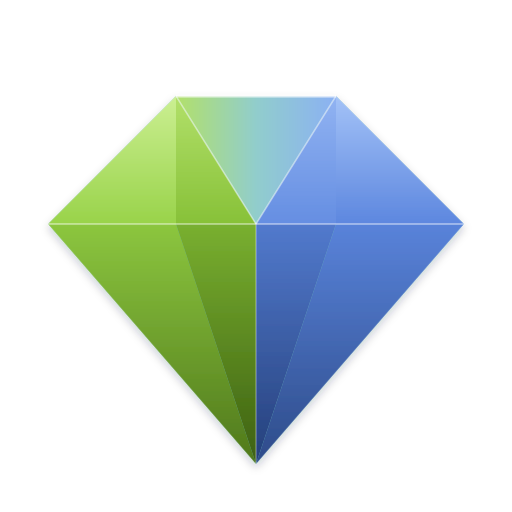
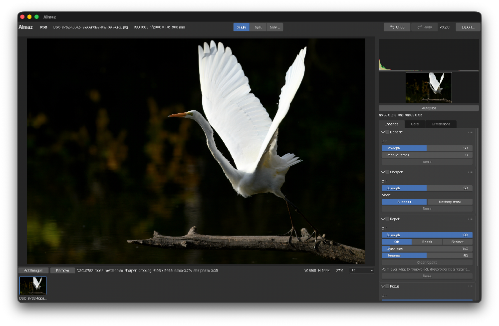

<p align="center">
  
</p>

# almaz



AI **denoise** and **sharpen** for photos (camera RAW, JPEG, PNG, TIFF) as a
native Clojure-on-Jolt app with a Blender-style UI (`glimmer-bui`). Inference
runs on open NAFNet models through ONNX Runtime: **Core ML (ANE/GPU)** on
macOS, CUDA/TensorRT on Linux, CPU everywhere.

See [PLAN.md](PLAN.md) for the target analysis and plan.

## What it does

- Opens RAW files at full resolution through LibRaw (Nikon HE included), plus
  JPEG / PNG / TIFF (8 and 16 bit). The camera's embedded preview shows while
  the RAW decodes. RAW files keep the exposure they were shot at: no
  automatic brightening.
- **Adding images**: Add images (⌘O / Ctrl+O), drag files or folders from
  Finder or the file manager onto the window, or open them with Almaz (Finder's
  Open With or the Dock icon, Nautilus' Open With, or as arguments:
  `Almaz *.NEF`). A folder adds the images directly in it, and the first image
  handed over is shown.
- **Filters are layers**, one of each, at a fixed place in the pipeline and
  switched on and off from their panel's header (changing a setting switches
  it on). Each runs over the composite of the layers below it and blends back
  through its **strength** and its own **mask**. Masks are painted with a soft
  round brush (size, hardness) and have a **feather** (gaussian) so edges blend
  smoothly into the layer below; Fill, Clear and Invert act on the whole mask.
- The sidebar has three tabs. **Enhance**: Denoise and Sharpen. **Color**:
  Light (exposure, contrast, highlights, shadows, whites, blacks, saturation,
  auto exposure), Levels (black/grey/white per channel over a histogram, with
  pickers), Curves (Luminance, RGB, Red, Green or Blue: click to add a point,
  drag it, double-click to remove it, or pick a tone from the image), Color Balance (cyan/red, magenta/green, yellow/blue, saturation
  and brightness for shadows, midtones and highlights), Hue & Saturation (with
  vibrance), Selective Color (hue, saturation, brightness for eight hue
  bands), Black & White (channel mix, toning, intensity) and Vignette. The
  colour maths follows darktable's modules (rgblevels, rgbcurve, colorbalancergb,
  colorequal, channelmixerrgb, vignette), written in Clojure (`almaz.color`)
  and drawn as 3D colour tables or per-channel curves, so the sliders respond
  as they move. **Dimensions**: rotate and flip, and crop by dragging a frame
  on the image, free, to an aspect ratio (original, presets, custom) or to a
  size (custom, presets). Nothing is resampled until export. A histogram of
  the result sits above the navigator.
- **Repair** (Enhance tab, or press R over the image): brush over a blemish
  or an object and it is filled from its surroundings: PatchMatch
  (multi-scale, with texture features so fine texture isn't filled with
  flat colour), light from darktable's healing solve across the edge, detail
  from the matched patches. It's a layer like the others: its mask is what's
  repaired, Restore paints a repair away, and repairs re-run when a layer
  below them changes.
- **Undo / Redo** (⌘Z / ⇧⌘Z, Ctrl+Z / Ctrl+Shift+Z on Linux, or the top bar): the
  last 10 edits per image, settings, switches, crop and turns, mask and
  repair strokes; a slider drag is one step.
- Filters run only when switched on. **Autopilot** (off by default in the
  app; the command line uses it) measures noise and sharpness when an image
  opens and switches on the filters it needs at suggested strengths.
- On macOS the picture on screen (the layer stack, colour adjustments,
  masks, crop and rotation) and the histograms are drawn on the GPU with
  Metal, falling back to the CPU without one (`ALMAZ_GPU=0` forces it);
  exports are always composited on the CPU at full precision. The AI filters
  run on the GPU through Core ML (ONNX Runtime's Core ML provider), which
  takes the whole NAFNet graph.
- Processing is tiled (512 px, crossfaded overlaps, no seams) and starts at
  the part of the image being viewed. Edits re-run only what they invalidate:
  a filter's settings re-run it and the layers above; its strength, mask or
  feather only re-run the layers above. Tiles a mask leaves untouched are
  skipped.
- Views: single, split (draggable divider) and side by side, with a navigator,
  zoom presets, eased wheel / trackpad zoom about the pointer, drag to pan
  (hold Space to pan while a mask brush is active), double click for fit /
  100%.
- Filmstrip of opened images; only the current one keeps full-resolution
  pixels.
- Export (⌘E / Ctrl+E) the full-resolution composite, cropped and turned, as JPEG (quality), 16-bit
  TIFF (no/LZW/Deflate compression), or 8/16-bit PNG (zlib level), in sRGB, Display P3 or Adobe RGB
  with the ICC profile embedded. The export panel shows the dimensions and an estimated file size. Exports
  keep the photo's shooting metadata (camera, lens, exposure, aperture, ISO,
  focal length, capture time) as EXIF. It is read from the source's own EXIF
  (JPEG, PNG, and TIFF-based RAW such as NEF/ARW/DNG/CR2) or, for other RAW
  formats, from LibRaw.

Timings on an M-series Mac (Core ML), 45 MP Nikon Z9 file: decode ~3 s,
denoise ~45 s, sharpen ~45 s for the whole frame, export ~6 s.

## Keyboard shortcuts

| Action | macOS | Linux |
|---|---|---|
| Add images | ⌘O | Ctrl+O |
| Export panel; again: choose where to save | ⌘E | Ctrl+E |
| Close the export panel | Esc | Esc |
| Undo | ⌘Z | Ctrl+Z |
| Redo | ⇧⌘Z | Ctrl+Shift+Z or Ctrl+Y |
| Zoom to fit | ⌘0 | Ctrl+0 |
| Zoom to 100% | ⌘1 | Ctrl+1 |
| Zoom in / out | ⌘= / ⌘- | Ctrl+= / Ctrl+- |
| Quit | ⌘Q | Ctrl+Q |

Over the image: hold Space and drag to pan, R picks the Repair brush, the
wheel zooms about the pointer, and a double-click toggles fit and 100%. The
shortcuts work wherever the pointer is, but not while a text field is being
edited (there ⌘Z / Ctrl+Z undoes the typing). They are listed in
`src/almaz/keys.clj`.

## Data model

Documents and their filter layers live in a [relatum](https://github.com/yogthos/relatum)
database (`almaz.doc`): `:doc` and `:layer` tables with typed columns, checks
(status and kind sets, opacity and every colour setting in range), a
cascading foreign key from layers to their document, and one layer of each
kind, at its kind's position, in a document's stack
(`:unique [[:doc-id :position] [:doc-id :kind]]`). A document's orientation and
crop are columns of its row (`almaz.geom`). Functions take the db and return the new one; the
app keeps it in one reactive cell (`almaz.state/db*`). UI-only state (view,
tool, selection, job progress) stays in plain cells.

## Layout

```
src/almaz/
  core.clj              the app: layout + -main
  ui/canvas.clj         image pane: rendering, overlays, pan/zoom/brush input
  ui/sidebar.clj        histogram, navigator, autopilot, the Enhance / Color /
                        Dimensions tabs + mask tools
  ui/chrome.clj         top bar, status bar, filmstrip
  ui/export.clj         export panel: format settings, colour profile, size
  ui/shortcuts.clj      binds the keyboard shortcuts (glimmer-bui bind-key!)
  ui/drop.clj           files dropped on the window or opened with the app (FFI)
  ui/units.clj          sizes in widget units (HiDPI)
  state.clj             reactive state: the relatum db + UI cells
  actions.clj           user commands
  worker.clj            background thread: what to do next; processing, export
  loading.clj           decoding, previews, thumbnails (for the worker)
  lifecycle.clj         native memory ownership (frees on the UI thread)
  doc.clj               data model: relatum tables (:doc, :layer), staleness
  view.clj              viewport math (pure)
  export.clj            export settings -> writer options, size labels (pure)
  keys.clj              keyboard shortcuts and their labels per platform (pure)
  files.clj             which files are images; what a dropped folder holds
  geom.clj              orientation, crop, display <-> source mapping (pure)
  color.clj             colour adjustments and their tables (pure)
  history.clj           undo / redo snapshots and stack (pure)
  tables.clj            colour tables built off the UI thread
  autopilot.clj         estimates -> layers (pure)
  engine.clj            runs one layer over the composite, tile by tile
  models.clj            model registry + sessions
  pixels.clj            FFI: native pixel engine
  raw.clj               FFI: LibRaw shim
  infer/                backend protocol, EP selection, tile planning,
                        ONNX Runtime + Core ML backends
native/
  img/                  pixel engine (C): 16-bit images + mip pyramid, masks,
                        compositing, tiles, filters, estimators, file I/O;
                        almazimg_metal.m draws the composite with Metal
                        inpaint.c fills repairs (PatchMatch + healing)
  onnxruntime/          C++ shim over ONNX Runtime (CPU, CoreML, CUDA EPs)
  raw/                  C++ shim over LibRaw
  coreml/               ObjC++ shim over Core ML (.mlmodelc)
  patches/              our changes to the BUI kit (trackpad scrolling; file
                        drops via Cocoa and XDND, and Open With)
  tools/                model export scripts, native build, packaging
test/almaz/             clojure.test suites (pure + native)
```

## Build

With jolt (and on macOS, Homebrew) installed:

```sh
jolt native     # build every native library (below)
jolt run        # the app
jolt test       # all suites
jolt check      # load every namespace
jolt samples    # fetch the RAW test files
```

`jolt native` installs whichever of `cmake jpeg-turbo libpng libtiff
onnxruntime` Homebrew is missing, fetches LibRaw (the 202611 snapshot, with the
Nikon HE decoder) and the BUI kit into `.deps/` at the commits CI pins, builds
them, then runs each `native/*/build.sh`. Rerunning it only rebuilds our shims.
`deps.edn` lists `.deps/bui/lib/libbui.*` for glimmer-bui, so no
`DYLD_LIBRARY_PATH` is needed. On Linux, install the apt packages from
`.github/workflows/ci.yml` first and set `ONNXRUNTIME_INC`/`ONNXRUNTIME_LIB`
to the ONNX Runtime release tarball to build that shim.

`deps.edn` pins a glimmer-bui commit that diffs props on re-render instead of
re-applying them (which relaid the whole UI and snapped sliders back
mid-drag), passes pointer positions to raw events, routes panel children into
the panel body, and adds layout/colour props, canvas items and the file
dialog.

## Models

Both are official NAFNet checkpoints (megvii-research; MIT, with parts from
BasicSR under Apache-2.0), exported to fixed 512x512 ONNX graphs. The app
downloads them on first use from the
[`models-v1` release](https://github.com/yogthos/almaz/releases/tag/models-v1)
and verifies each against its pinned SHA-256 (`almaz.models/registry`) before
using it. They go to `~/Library/Application Support/almaz/models` on macOS,
`$XDG_DATA_HOME/almaz/models` (or `~/.local/share/almaz/models`) on Linux,
`models/almaz` in a source checkout, or `$ALMAZ_MODELS` when set.

To re-export them yourself, `native/tools/export_nafnet.py` defines the
architecture inline and loads checkpoints with torch's safe `weights_only`
unpickler:

```sh
mkdir -p models/ckpt models/almaz
curl -L -o models/ckpt/NAFNet-SIDD-width64.pth \
  https://huggingface.co/spaces/chuxiaojie/NAFNet/resolve/main/NAFNet-SIDD-width64.pth
curl -L -o models/ckpt/NAFNet-REDS-width64.pth \
  https://huggingface.co/spaces/chuxiaojie/NAFNet/resolve/main/NAFNet-REDS-width64.pth
# sha256: cd685efa... (SIDD), 175fe8b3... (REDS)
python3 -m venv native/tools/venv && native/tools/venv/bin/pip install torch onnx onnxscript
native/tools/venv/bin/python native/tools/export_nafnet.py \
  models/ckpt/NAFNet-SIDD-width64.pth models/almaz/nafnet-sidd-512.onnx --arch sidd
native/tools/venv/bin/python native/tools/export_nafnet.py \
  models/ckpt/NAFNet-REDS-width64.pth models/almaz/nafnet-reds-512.onnx --arch reds
```

The first run on macOS compiles each model for Core ML (cached in
`~/Library/Caches/almaz/coreml`).

The automatic masks (Subject, Background, Portrait, Landscape, Sky) use two
more models, fetched the first time one is picked:

- BiRefNet-lite (ZhengPeng7, MIT), the ONNX export onnx-community publishes,
  downloaded from Hugging Face: salient object (Subject, Background).
- UperNet + ConvNeXt-tiny (openmmlab, MIT) on ADE20K, exported with its
  classes summed into sky, person and landscape probabilities (Sky, Portrait,
  Landscape). It goes on the `models-v2` release; to export it yourself:

```sh
native/tools/venv/bin/pip install "transformers<5"
native/tools/venv/bin/python native/tools/export_scene_seg.py models/almaz/upernet-convnext-tiny-512.onnx
```

Lens correction uses the [lensfun](https://github.com/lensfun/lensfun)
database (CC-BY-SA 3.0), converted into `src/almaz/lens/db.clj`:

```sh
native/tools/venv/bin/python native/tools/lensfun_to_clj.py ~/src/lensfun/data/db
```

> The Qualcomm AI Hub NAFNet exports used earlier are **not** used: both blow
> up (outputs in the hundreds) on real photos. Also note the models expect a
> demosaiced image: LibRaw's half-size decode leaves per-pixel independent
> channel noise that the SIDD model has never seen, so the app always decodes
> RAW at full resolution.

## Packaging

```sh
jolt release   # the host platform's bundle (see below); `jolt dist` is an alias
```

On macOS this writes `target/Almaz.app` and
`target/Almaz-<version>-macos-arm64.zip`. `native/tools/package_macos.clj`
builds the app with `jolt build`, copies almaz's native libraries, the BUI kit
and everything they load from Homebrew (about 100 dylibs) into
`Contents/Frameworks`, relinks them to `@rpath`, and signs the bundle: ad-hoc by
default, or with `ALMAZ_SIGN_IDENTITY="Developer ID Application: ..."`. The
bundle's executable is a small launcher that puts `Contents/Frameworks` on
`DYLD_LIBRARY_PATH` before running the app (so a notarized build with hardened
runtime needs the `com.apple.security.cs.allow-dyld-environment-variables`
entitlement). Apple Silicon only; models are downloaded on first use rather than
bundled. The launcher also serves the command line:
`Almaz.app/Contents/MacOS/Almaz --help`. Info.plist declares JPEG, PNG, TIFF
and camera RAW (`public.camera-raw-image`) as documents Almaz can open, so it
appears in Finder's Open With; those files reach the running app as Apple
events, not arguments.

On Linux it writes `target/Almaz-linux-<arch>/` and
`target/Almaz-<version>-linux-<arch>.tar.gz`:

```
Almaz-linux-x86_64/
  bin/Almaz                 launcher (sets LD_LIBRARY_PATH to lib/, runs almaz-bin)
  bin/almaz-bin             the app built by `jolt build`
  lib/                      Almaz's native libraries, the BUI kit, and their
                            non-system dependencies (ONNX Runtime, …)
  share/applications/almaz.desktop   Exec=Almaz %F, with the image and RAW MIME
                                     types, for the file manager's Open With
  share/doc/almaz/LICENSE
```

`native/tools/package_linux.clj` follows `ldd` recursively, copies everything
outside the distro's `/lib`, `/lib64` and `/usr/lib` trees, and keeps each
library's SONAME as a symlink. Libraries the host must provide (glibc,
libstdc++, X11/OpenGL and the X11 build of the image codecs) are not bundled;
install them with the distro. When `patchelf` is available the bundle also gets
`$ORIGIN` rpaths, so `bin/almaz-bin` runs without the launcher. To use the
desktop entry, install the tree under `/opt/almaz` and symlink
`bin/Almaz` into `PATH` (the entry's `Exec=Almaz`).

## Run and test

```sh
jolt test      # all suites (pure + native; `jolt -M:test pure` for the pure ones)
jolt check     # load every namespace
jolt run       # the app (opens DSC_9852.NEF when present, or files given as args)
```

Batch processing (no window) whenever an option is given:

```sh
jolt run --showSettings DSC_9852.NEF                     # autopilot picks the filters
jolt run --noise strength=60 -o out *.NEF                # adjust what autopilot chose
jolt run --override --sharpen model=classic radius=2 x.jpg   # exactly these filters
jolt run --light exposure=auto contrast=15 *.NEF         # light adjustments on top
jolt run --help                                          # every option
```

Results are written as `<name>-almaz.<ext>` with the input's EXIF; the exit
status is 0 when every file went through, 1 when some failed, 2 for a usage
error.

Interactive development: `jolt nrepl-server`, then from the REPL

```clojure
(require '[glimmer.core :as ui] '[almaz.core :as core] '[almaz.worker :as worker]
         '[almaz.actions :as act])
(worker/start!)
(act/add-images! ["DSC_9852.NEF"])
(ui/run core/app :title "Almaz" :width 1500 :height 960)   ; returns; the REPL stays live
;; after editing: (require 'almaz.ui.sidebar :reload) (ui/reload! core/app)
```

Native libraries can't be reloaded: restart the server after rebuilding one.
`ALMAZ_SCRIPT=file.clj jolt run` loads a file shortly after startup (driving
the UI in smoke tests).

## License

GPL-3.0 (glimmer-bui's BUI kit and the shims are GPL). The NAFNet
weights are MIT licensed (Copyright (c) 2022 megvii-model), with parts from
BasicSR under Apache-2.0; the release ships their license text.
